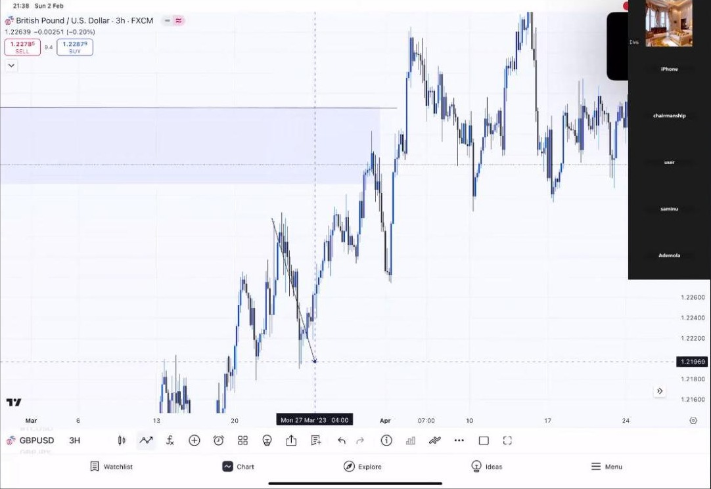
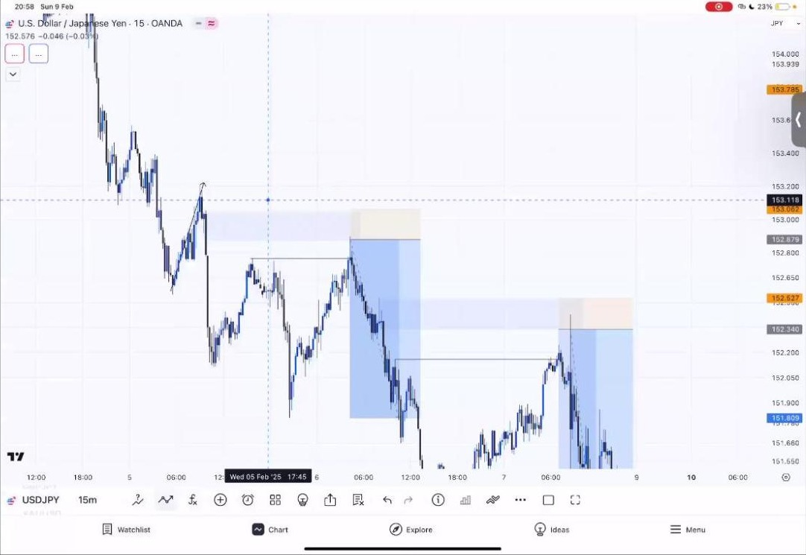
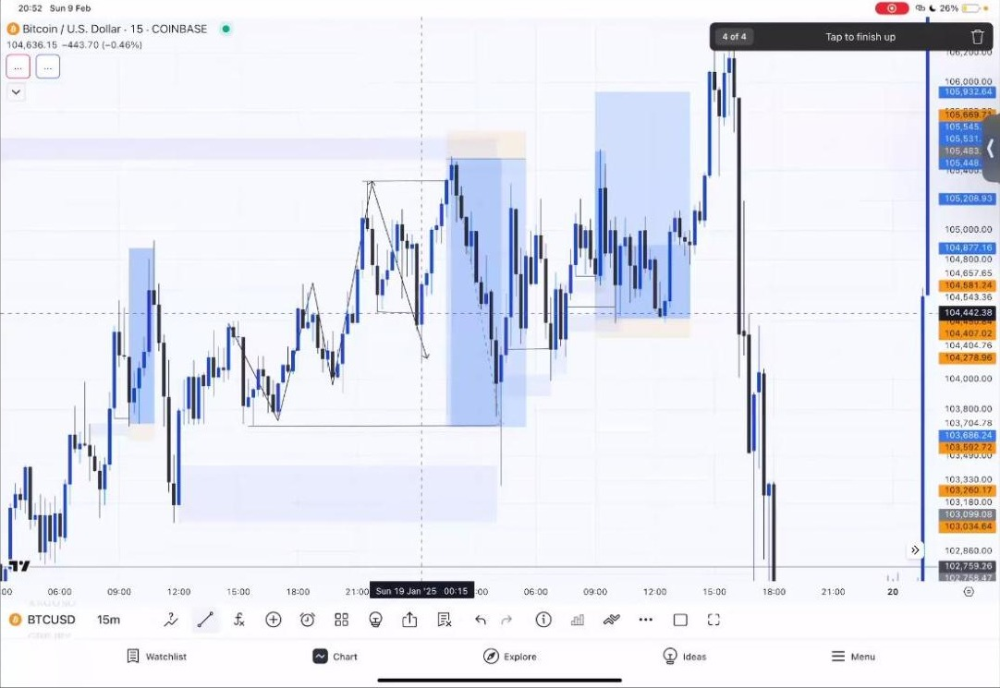
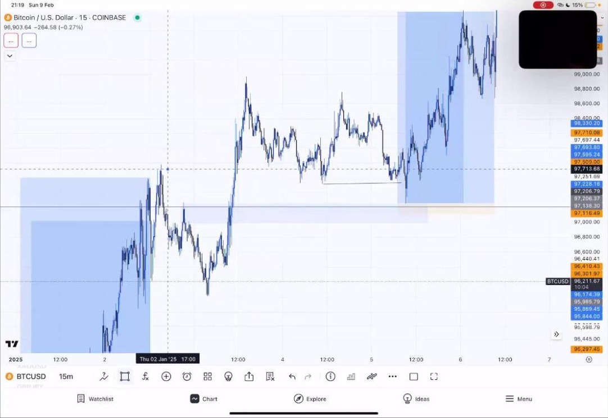
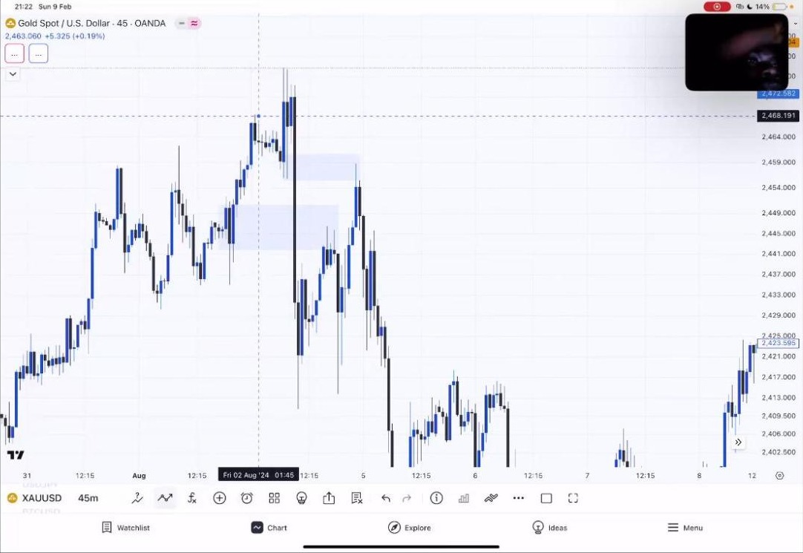
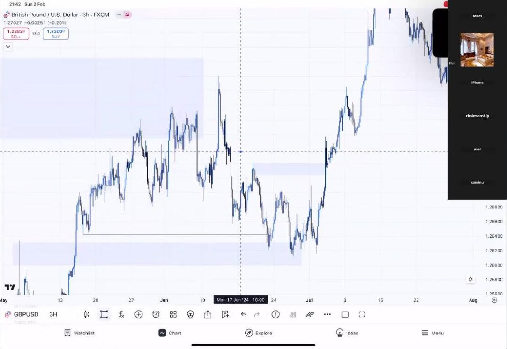
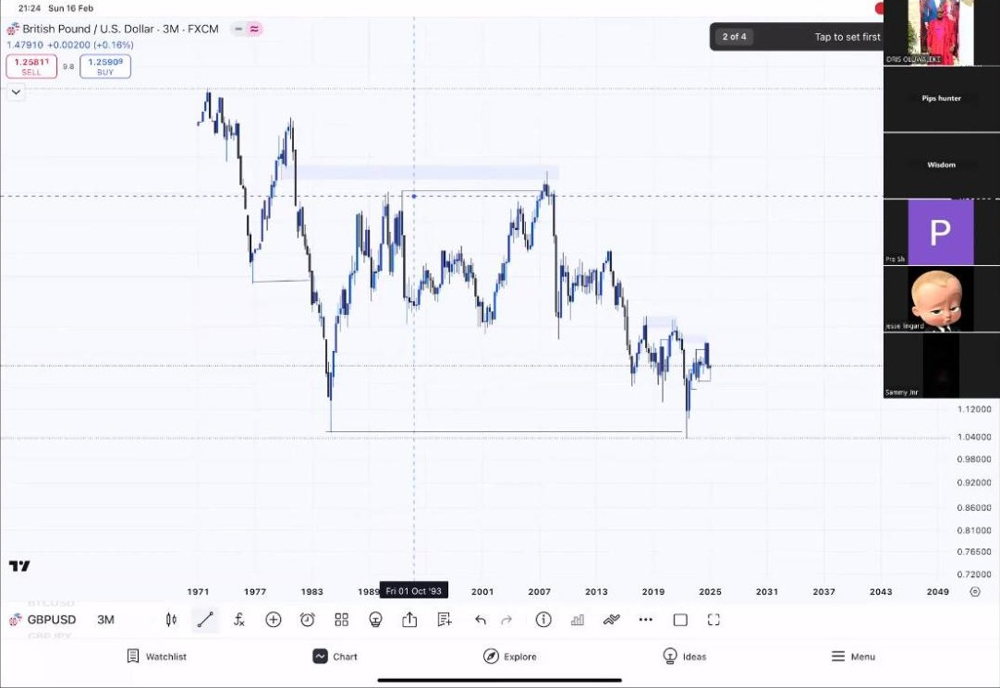
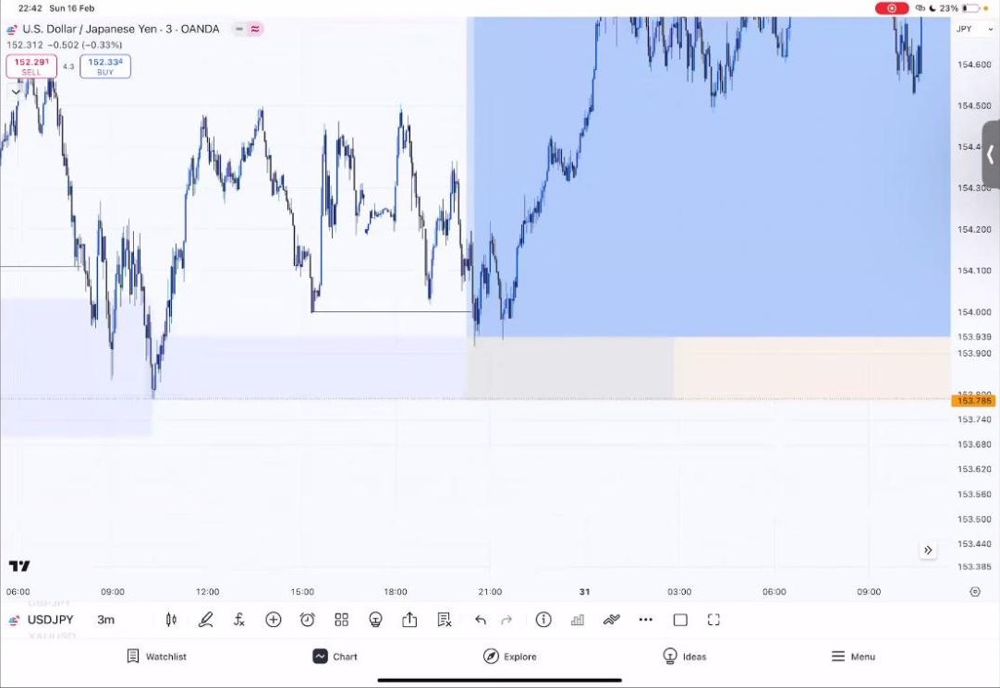

# Lingard's Strategy ("Advanced SMC") — Notes for Bot Training

Compiled 27 Nov 2026 from the YouTube transcripts of:
- Lingard's February class series (11 videos, re-uploaded on the *MENTOR SESSION* channel)
- the "Putting everything together" Q&A session (the same session as the 2h38m "Lingard complete strategy" upload)
- the earlier leaked course (Class 1–4, Final Class and Trade Analysis on *LEAKED FOREX COURSES & FINANCE*)
- the "Top down Analysis full course" (SOLOFXM)

Chart frames are in `frames/`. Lines marked **[v2]** came from the second batch: the leaked course and the top-down course.

**How to read these notes**
- Everything under sections 1–7 is Lingard's own teaching. Where the auto-captions were garbled and I had to interpret, it is marked *(interpretation)*.
- Section 8 is from **Jax** (the MENTOR SESSION channel owner), who teaches "the Lingard method" but adds his own Fibonacci rules for validating inducements. Keep it separate: it is not Lingard's.
- Lingard teaches by pointing at charts, so the captions often say "this zone" or "here". The rules below are the parts he stated clearly or repeated several times.

---

## 0. The framework in one line

> **Market Structure → Liquidity → POI (Order Block or Breaker Block)**, applied top-down: HTF tells you *where* price is going (directional bias), LTF gives you the *entry*.

He calls it "Advanced SMC". There are only two POI types: the **Order Block (OB)** and the **Breaker Block (BB)**. The classes ran in this order: (1) market structure, (2) liquidity + POIs, (3) top-down analysis / directional bias, (4) confirmation entry + Q&A.

---

## 1. Market structure (Class 1)

### 1.1 Trend states
| State | Definition (his words, cleaned) | What to do |
|---|---|---|
| Uptrend | Price keeps breaking higher highs **and the low stays protected** (not violated) | Only buy |
| Downtrend | Price keeps breaking lower lows and the high stays protected | Only sell |
| Ranging / consolidation | Price breaks back and forth inside a high–low zone without pushing out either side | **Stay off.** If you must trade it, short scalps only. No long holds, no waiting for liquidity plays |

He says the breakout from a consolidation is when price "starts moving well".

**[v2]** In a range, mark the *main* high and *main* low. Price can break smaller structures inside the box many times, and that does **not** mean the range is over. The range only ends when the main high or the main low is taken.

**[v2] What counts as a break of structure:** a BOS is a break of the last high or low. When it's in the direction of the trend, **a wick through the level is enough**. He doesn't require a candle close.

### 1.2 External vs internal structure
- **External structure** = the main swing highs and lows that price has to take out. These come from the bigger timeframe and give you the *vision* of where price is heading.
- **Internal structure** = the smaller structures that form *inside* the external range. You see them on lower timeframes. This is where you take entries.
- "External structure gives you the expectation. Internal structure gives you the entry."

### 1.3 Major vs minor shift (CHoCH / MSS)
- **Major shift** = price breaks an **external** high or low. This is a real change of character.
- **Minor shift** = a change of character **inside internal structure**. **Avoid it.** Treat it as a trap.
- Typical trap: external high not yet taken, price reaches a supply zone, gives a minor bearish shift. Sellers enter on it, price liquidates them, then takes the external high. Lingard says he takes most of his trades by fading these minor shifts.
- In the Q&A he says he barely uses the word "change of character" at all. If you're on the right side of the HTF trend, counter-trend CHoCHs don't matter.

### 1.4 After an external high or low is taken → expect a reversal
- "When a big high has been taken out, expect a reversal. That reversal is taking out liquidity before price continues."
- It isn't guaranteed, but "it's something market will always do". So be careful taking more entries in the same direction right after an external high or low has been swept.
- In top-down analysis this is also how his bias flips. If the HTF external low has been taken, he expects a retracement up into the HTF POI and buys on LTF until price reaches it.

### 1.5 Protected highs and lows
- A low is **protected** (valid to build a buy on) when **liquidity was swept below it** before price moved up and broke structure.
- A low with untouched liquidity resting just below it is **not** protected. Expect price to come back for it.
- Pattern: sweep → structure break → pullback (liquidity) → POI → continuation.

### 1.6 A structure break with no liquidity usually fails
- A clean BOS with no pullback or liquidity behind it is "weak". Price may respect the OB briefly, then reverse to take that low or high as liquidity.

---

## 2. Liquidity (Class 2)

### 2.1 What counts as liquidity
Double tops and bottoms, **trend liquidity** (price stair-stepping with the same strength along a line), obvious highs and lows, and equal highs and lows. "Liquidity is everywhere. The question is which one is valid to trade."

A **long-wick candle that forms before the structure break** also counts as liquidity. On a lower timeframe it is a full reaction.

**[v2] External vs internal liquidity:**
- External liquidity = swing highs and lows, equal highs and lows, double tops.
- **Internal liquidity sits inside FVGs.** He says: "FVG creates liquidity." A pullback into an FVG after a break often creates the liquidity that makes the OB below it valid.
- It's "not a must", but he says you'll see it most of the time.

**[v2] He does not teach QM/QML.** When a student asked about it, he said to leave it out.

### 2.2 The two patterns he trades (core of the strategy)

**Pattern A: first pullback BEFORE the break of structure**
1. Price makes a pullback, then breaks the high (BOS).
2. That **first pullback before the BOS** is the liquidity.
3. Price comes back, takes that liquidity, taps the POI **closest to it** (OB or BB), and continues.

**Pattern B: first pullback AFTER the break of structure**
1. Price breaks structure with no prior pullback.
2. The **first pullback after the BOS** becomes the liquidity.
3. Price comes back, takes it, taps the POI near it, and continues.

Rules attached to both:
- It must be the **first** pullback. With multiple pullbacks or a run of structure breaks, the first one is the valid liquidity. Students who used a later pullback got stopped out.
- **The POI must be near the liquidity.** After a sweep, price picks the nearest zone. It does not leave that zone to go to a far OB.
- **"We don't trade supply and demand without liquidity. We wait for liquidity and we trade with liquidity."**

**[v2] More detail on Pattern B (from the leaked course):**
- Price breaks the high immediately, with no pullback. Then it gives a pullback, often into the FVG. Then it **breaks another high**.
- That pullback is now the liquidity, and the OB below it is the POI. Price returns to take the liquidity and taps the OB.
- "It looks like you missed the trade, but you haven't."
- He says Pattern B "is not always seen". Pattern A is the one he meets most often.

**[v2] A single structure with no liquidity is not a setup.** If price breaks once and there's no pullback, the OB at that break "is not valid for you". Wait. Price will usually come back, create liquidity, and then go to the lower POI. When there are two POIs, pick the one *beyond* the first pullback, not the one in front of it.

**[v2] Multiple sweeps and re-entries:** if price sweeps, builds a new structure, then sweeps again, continue from the newest sweep and structure. Being swept out once doesn't kill the idea if the trend still holds.

**[v2] Continuation inside a trend:** after several BOSs in a row, you can trade the pullback before the next BOS. Treat it as short-term and take profit early. Price can fail at the next high and reverse.

### 2.3 Inducement / fake zone
- Price doesn't always fully take the high or low. Often it breaks a small zone and **creates a fake demand or supply zone** to trap early buyers or sellers, then drops to the real POI.
- "Inducement zone = a zone that encourages buyers or sellers but is not a valid zone."
- **Trend liquidity** that builds up before a POI usually gets taken out entirely before the real move.

### 2.4 Liquidity sweep makes a POI valid
- "What makes a zone valid is liquidity take-out." When picking an OB, check that liquidity was swept just before or into it.

---

## 3. POIs: Order Block and Breaker Block

### 3.1 Order Block (OB)
- The standard SMC order block (the last opposite candle zone before the impulsive move).
- **The OB is stronger than the breaker.** Use the breaker when there's no OB close to the liquidity.
- **[v2] How he marks it:** use the **whole candle, wick to wick**. If two or more consecutive candles caused the break, mark the whole group starting from the first one.
- **[v2] When both a breaker and an OB are present:** price goes to the one **nearest the liquidity** first, which is often the breaker. The breaker's reaction then builds liquidity, and price can come back later for the OB.

### 3.2 Breaker Block (BB) = a failed order block
Validity checklist (he listed these in order):
1. **A break.** Price breaks through the OB (for a sell breaker, price first breaks *up* through a supply OB).
2. **Inefficiency / FVG inside the zone.** "Not a must, but the majority of the time" there's an FVG.
3. **Liquidity.** The first pullback after the break *does not touch* the breaker. It just creates liquidity.
4. **Return.** Price comes back, takes that liquidity, enters the breaker, and continues.

**Multiple failed OBs (his own finding, which he says nobody taught him):**
- When price breaks several OBs in a row, it often comes back into the **second** one first. That gives a short reaction which creates liquidity. Then price goes to the **first OB that failed to hold**, and that is the real entry.
- "The first breaker that failed is my target."
- **[v2]** In the leaked course he repeats the three criteria for a breaker in this order: **structure → inefficiency/FVG → liquidity**. When there are 2–3 failed OBs, price uses all the later ones to build liquidity (wicks, small reactions, a mini consolidation) before it reaches the first failed OB.
- **[v2] Immediate return:** sometimes price breaks and comes straight back into the breaker with no pullback first. Lingard says this is **"not a long-time buy"**. Only take it as a short trade to the nearest high, and only if you really understand it. Otherwise skip it because it's risky.

### 3.3 Picking and refining the POI
- **Mark POIs on higher timeframes.** Use lower timeframes only for entries. "Lower timeframe is full of manipulation." On LTF, an HTF breaker can look mitigated when it isn't.
- If the HTF POI is big, which means a big stop loss, drop to 15m, 5m or 3m and use the **unmitigated OB inside it that sits nearest the liquidity**. Bonus if its wick is protected by a small sweep.
- If an OB sits inside the breaker on LTF, you can use the OB because it lines up with the breaker.
- An **FVG retracement** after a break often creates the liquidity for the OB below it.
- **[v2] Use the timeframe that shows clean structure.** If the 1H or 2H shows the OB as mitigated or the structure is messy, but the 15m or 30m shows a clean structure with liquidity and an OB, follow the lower timeframe for that setup.
- A breaker that has already been mitigated can still produce a new structure, liquidity and OB inside it for another entry.

### 3.4 When price doesn't reach your POI (his recent adjustment)
- In fast, high-momentum markets, price often sweeps the liquidity and leaves without touching the main breaker or OB.
- His fix: **once the liquidity is taken, go to LTF and use the nearest realistic zone** (a small breaker or OB reaction right after the sweep) with a tighter stop. Don't keep waiting for the far POI.

---

## 4. Top-down analysis = directional bias (Class 3)

1. **Open the timeframe that shows everything that has happened on the chart.** He refuses to give a fixed timeframe. In practice he starts at **3M or 1M**, then goes to 1W, then 2H or 1H, then 15m, 5m, 3m or 1m.
2. On that HTF, apply the **same strategy**: structure, liquidity, POI. Find where price is heading (the next external high or low, the next HTF POI).
3. If an **HTF external low or high has already been taken**, expect a reversal into the HTF POI. Trade *with* that retracement on LTF until price reaches the POI, then switch direction.
4. Drop to lower timeframes and **only take setups that agree with the bias**. "If bias is bullish, all you're looking for is buys."
5. Ignore counter-bias CHoCHs inside the zone. They are internal or minor.
6. If HTF is selling while the daily is buying, the daily buy is a **retracement grabbing liquidity before the sell**. You can trade those buys toward the HTF POI. Then sell.
7. **[v2] His exact sequence in the Final Class:** 3M → 1W/1M → 1D → 4H → 2H → entry timeframe. On each timeframe he marks protected highs and lows and which lows or highs have already been taken.
8. **[v2]** If HTF price swept its main low and is bouncing from HTF demand with a **V-shaped reaction**, he reads that as the demand being respected. LTF sells in that phase are weak and short-lived, so expect HTF price to retrace up first.
9. **Study how each pair reacts.** For example, he says BTC and gold keep reacting from breakers on HTF. Patterns repeat per instrument.

---

## 5. Entries

### 5.1 Standard entry
Liquidity taken, then price taps the POI (OB or BB) nearest that liquidity. Enter there. The stop goes beyond the POI or the low it protects. The target is the next liquidity or external high/low in the bias direction.

### 5.2 Confirmation entry (lower-timeframe re-entry)
Use it **when the POI is big** (a wide stop). If your stop is already fine, he says he mostly doesn't bother.

Inside the POI, on 5m, 3m or 1m:
1. **Sweep** of liquidity
2. **Change of character**
3. **Retracement** to the OB that caused the CHoCH → enter
4. **Stop beyond that small OB**, not beyond the whole HTF POI

Pros: much better R:R, and it avoids getting caught by aggressive entries. Con: you sometimes miss the trade while waiting.

He says plainly: **"I don't use candles"** (candlestick patterns) for confirmation. Only the sweep, CHoCH and retracement.

**[v2] Extra details from the Final Class:**
- **Entry timeframes are 3m and 5m.** On gold, 1m "always works".
- **Order blocks give these entries much more often than breaker blocks.**
- Variant: on the LTF he doesn't always wait for a fresh LTF liquidity sweep. He can enter at the initial LTF demand or supply that caused the CHoCH, with the stop just beyond that LTF low or high. His reasoning: the stop is tiny, so if it's hit, the analysis was wrong.
- This is the model he uses for small-account "flips". His example used about a 2-pip stop with 1–2 lots, targeting around 400–500 dollars on a 30-dollar risk.

### 5.3 Taking profit [v2]
- Target the next liquidity or high/low in the direction of the bias.
- If you expect a reversal at that level (for example, it's an external high), **take profit at the sweep**. Don't hold through it.
- On counter-trend or continuation scalps, take profit early.

### 5.4 Execution
- He uses **instant execution**, then sets the SL. He stopped using limit orders after one didn't fill and price ran to his target.
- He sizes lots by dragging the SL in MT5 and reading the dollar risk. He doesn't use a pip calculator.

### 5.5 Trading against the trend
- Generally don't. If you do, treat it as a **short scalp** targeting the nearest liquidity, not a swing.

---

## 6. Risk and discipline rules (from the Q&A)

His personal rules list:
- No revenge trading
- Limit trades per day (caption: *"trade a day max three"*, interpreted as max ~3 trades/day)
- **2 stop losses in a day → done for the day**
- Avoid night trading (slow, unclear movement, wide spread)
- Don't trade against the trend
- Only take high-probability setups (ones you don't have to second-guess)
- Minimum **R:R 1:5–1:6**. He says 1:5 is easy to catch with this method.
- Journal every trade with screenshots. After each loss, find the mistake and turn it into a rule.
- **Forward-test rather than backtest.** Mark the analysis, screenshot it, let it play out. He says replay backtesting is "telling yourself lies". He also suggests a 10-trade challenge: log wins and losses and review each loss.

> ⚠️ **His compounding plan risks 10% of the account on the first trade, then risks the profits.** That is far above normal risk limits (usually 0.5–2%). I'd set the bot's risk per trade separately and not copy this.

---

## 7. Pairs, timeframes, sessions
- Instruments in his examples: GBPUSD, GBPJPY ("GJ"), USDJPY ("UJ"), XAUUSD (gold), BTCUSD, US30.
- On gold and BTC, don't do analysis on low timeframes. They're too volatile. Use LTF only once price is already moving from your HTF POI.
- He day-trades and swing-holds only when HTF supports it (he mentions holding 1:26 trades).

---

## 8. Supplementary: Jax's inducement validation (not Lingard's own rules)

From the MENTOR SESSION channel owner's video "How to Validate Inducement". It adds measurable thresholds that work well in code:
- **Complete inducement** = the pullback breaks structure. **Engineered liquidity** = it doesn't break, only retraces.
- Before an inducement forms, price should retrace **≥ 50%** of the swing (Fib from the low that made the high to the high).
- For engineered liquidity, the bounce should retrace **≥ 70–80% of the leg, ideally 80–100%**. 100% is a double top/bottom (best). Around 50–60% "hardly holds".
- **The inducement must not touch the POI** (exception: the POI has a long wick and the inducement only taps the wick).
- **An inducement that forms before an MSS is invalid.**
- Don't use a single-candle inducement right after an MSS.
- After price takes a **strong high or low**, only trust a *complete* inducement.
- **Avoid engineered liquidity after a long one-directional trend.** Expect a deeper retracement instead.

---

## 9. Coverage and caveats
- **Processed (19 videos):**
  - February class series: 11 videos
  - "Putting everything together" Q&A. The 2h38m "Lingard complete strategy" upload by *Destiny The Developer* is the same session, so I didn't process it twice.
  - Leaked course: Class 1, 2, 3, 4, Final Class and Trade Analysis (6 videos)
  - "Top down Analysis full course"
- The leaked course is the earlier, more basic version of the same method. It confirmed the February rules and added the **[v2]** details. It contradicted nothing.
- The Trade Analysis video cuts off at around 18 minutes because of his network.
- The captions are auto-generated (Nigerian English + Pidgin, poor audio), so exact numbers were sometimes unclear.
- The chart frames are from his iPad screen-share. Zones show as light blue boxes and the lines are thin.
