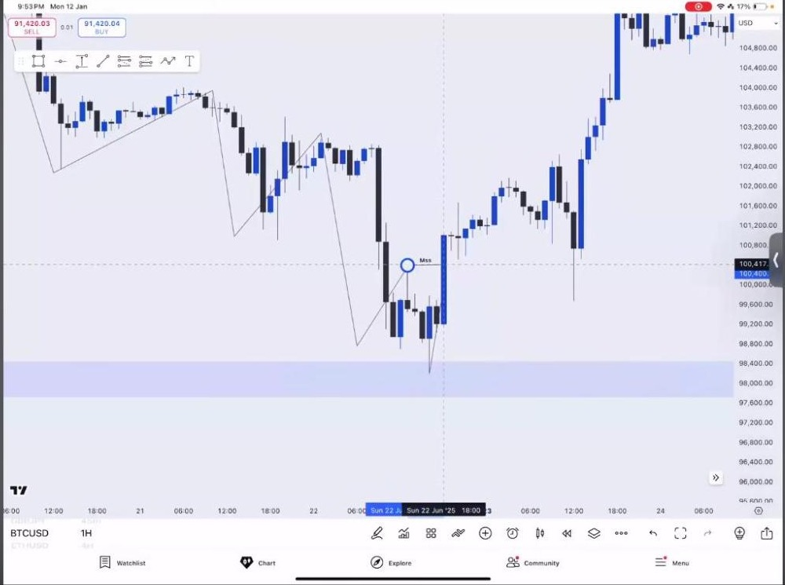
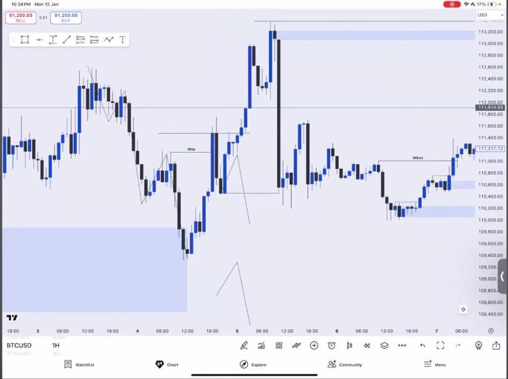
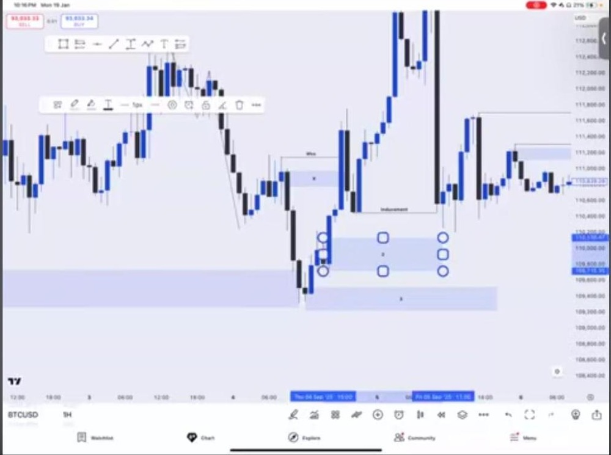
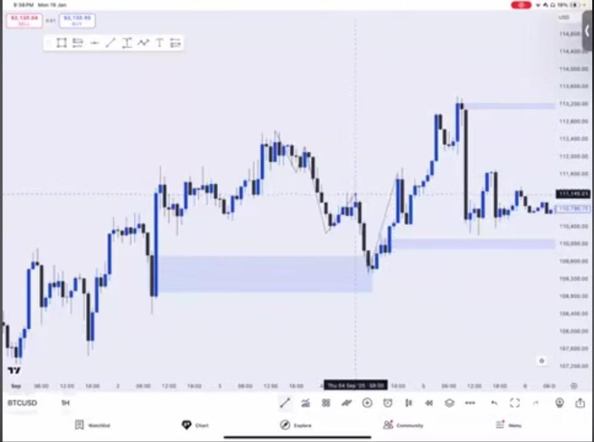
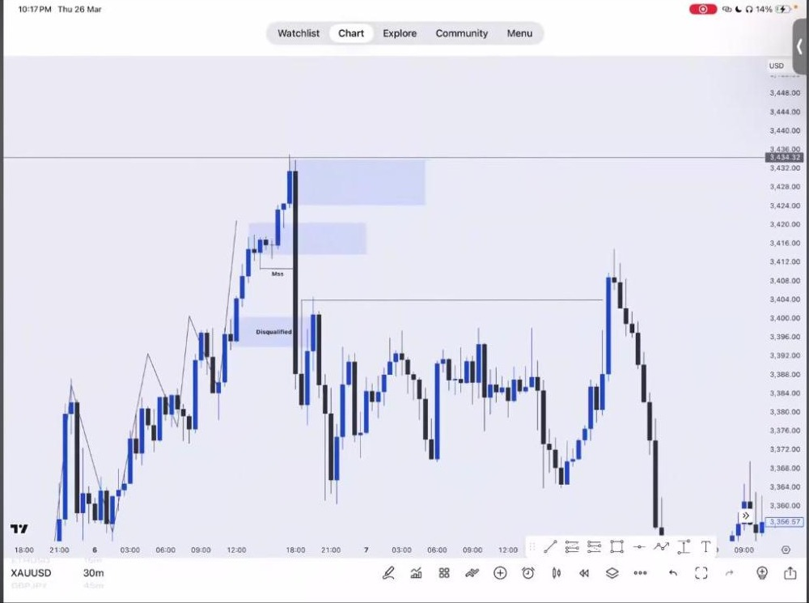
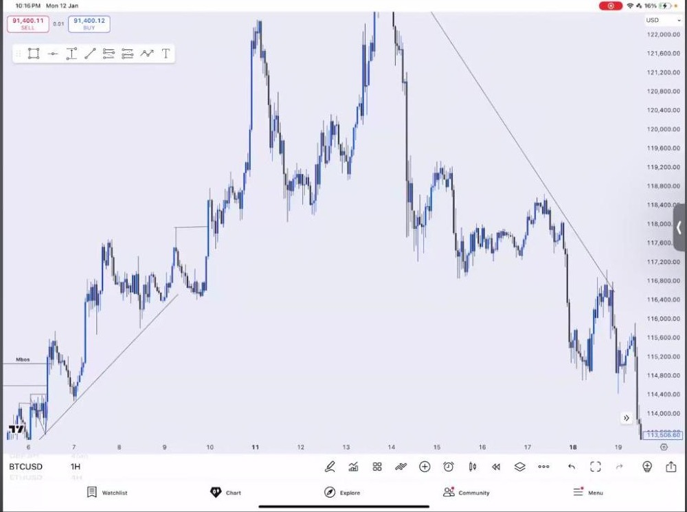
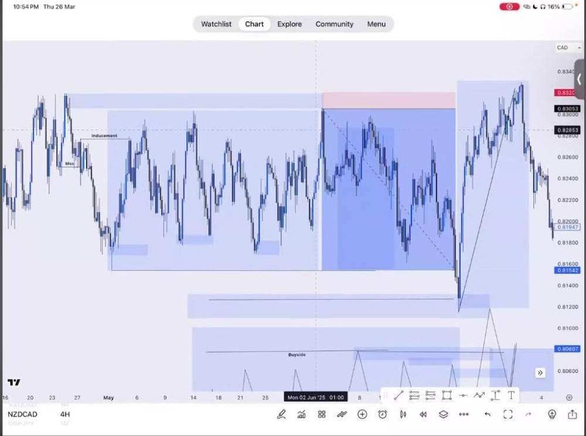

# Toni Iyke Strategy: Leaked Mentorship Notes for Bot Training

Compiled 27 Nov 2026 from the transcripts of the leaked mentorship recordings in the *"Tony Iyke Strategy"* playlist (LEAKED FOREX COURSES & FINANCE, 23 videos). The playlist repeats one syllabus across cohorts (June, August and October 2025, then January and March 2026), so I used **the most recent class for each topic** plus the two one-off videos:

| # | Video | Topic |
|---|---|---|
| 1 | January 2026 Mentorship: Market Structure (1h50) | Structure, MSS, multiple BOS, inducement, order blocks |
| 2 | January 2026 Mentorship: Part 2 (1h06) | Breaker blocks + **the 4 rules for picking a POI** |
| 3 | March 2026 Mentorship: How to Spot Liquidity (1h19) | Liquidity types + take-profit |
| 4 | October 2025: Directional Bias (2h13) | HTF bias + confirmation |
| 5 | Taking Profit with Liquidity (28m, older) | Extra liquidity types (equal highs/lows, long wick) |
| 6 | Trading Plan (14m) | Planning and position sizing |

I also checked "October Mentorship: Point of Interest", but it actually covers liquidity again, so it adds nothing new.

Chart frames are in `frames/`. Anything marked *(interp)* is my reading of unclear captions. Everything else is what he said.

---

## 0. The framework

> **Directional bias (daily/4H) → Market structure (MSS for reversals, multiple BOS for continuations) → Liquidity (inducement) → POI (order block or breaker) picked with 4 rules → Exit at liquidity.**

- **Four concepts only:** market structure, liquidity, point of interest, directional bias.
- **No fair value gaps, and no premium/discount zones.** He says: "anything I didn't teach, I don't trade."
- **One timeframe for analysis and entry.** He mostly trades the 1H as a day trader, and drops lower only when the market is very volatile. "Time frame does not matter."
- **Instruments:** mainly gold and BTC (crypto and commodities). He says currency pairs range more.

---

## 1. Market structure

### 1.1 Three movement patterns
- **Uptrend:** higher highs and higher lows.
- **Downtrend:** lower highs and lower lows.
- **Range:** horizontal movement between support and resistance.

### 1.2 Reversals vs continuations
- From any trend you expect either a **continuation** or a **reversal**.
- Reversals only apply to trending markets. Continuations apply to trends and also to range breakouts (break and retest).
- **"We trade continuations more times than reversals."** A reversal happens once, at the start of a new leg. Every entry after that in the new direction is a continuation.

### 1.3 Market Structure Shift (MSS): the reversal tool
- **Definition:** a sign that the current trend is ending and a new one is starting in the opposite direction.
- **It is only valid at a zone you marked in advance:**
  1. a **higher-timeframe POI**, meaning a daily (or 4H) order block or breaker; or
  2. a POI with an **extremely large candle body**. This needs an extra confirmation, but it lets you tighten the stop.
  - "80% of the time it's at a daily POI." An MSS at a random spot usually fails. He is wary of MSS at all-time highs, because there's no higher-timeframe zone there.
- **What triggers it (bullish):** price is making lower highs and lower lows into the zone. Then, instead of another lower low, it **takes out the last lower high and closes above it with a candle body**. A wick through doesn't count. The bearish version is the mirror image.
- When price reaches the zone, it either fails (the trend continues) or gives an MSS. **Never buy the zone without the MSS.**
- For a reversal, taking out **one level is enough**.

### 1.4 Multiple (double) Break of Structure (DBOS/MBOS): the continuation tool
- **A single BOS is ignored.** After a single break, the pullback is shallow and you can't predict where it will stop, so it often leaves before reaching your POI.
- **A multiple BOS is traded.** This is when one leg takes out **two or more levels** while the trend continues, and closes beyond them with a body.
- **January 2026 refinement:** the levels broken should include **an internal level** (a high or low made during the current trend) **and an external level** (a high or low made during the previous, opposite leg). Two internal highs alone often fail to pull back to the breaker. His simpler fallback is just "more than one level."
- It doesn't have to be one candle, though it usually is. A close only slightly beyond the level still counts.
- **One structure type per setup.** Use MSS for reversals and DBOS for continuations, never both at once.
- **First-time reversal order:** if an MSS's POI hasn't been tapped yet, any DBOS that forms afterwards is **invalid**. Wait for the MSS POI to be tapped first.

---

## 2. Liquidity for entries: the inducement
For entries he uses **only the inducement**. The other liquidity types are for exits (section 5).

- **Inducement** = the **first valid pullback after an MSS or a multiple BOS**.
  - It can be a full retracement (an opposite candle closes, then a trend candle) or a **single-candle wick**.
  - A volatile market tends to give wick-type inducements.
- **What makes it valid:** after the pullback, price must break **and close with a body** beyond the **body close** of the MSS or DBOS candle (the body, not the wick).
  - Until that happens there is no inducement yet. Keep waiting, because a later pullback can become the inducement.
- **What it's for:** it's confluence that the structure is real, and it's a trap. **Don't enter at it.** Price must come back, take out the inducement, and then tap the POI.
- **No inducement → no trade.** He admits there are "a few scenarios" where price taps the POI without one.

---

## 3. Points of interest

### 3.1 Order block (OB)
- **Bullish OB** = a bearish candle followed by a bullish candle that engulfs it. The bearish OB is the mirror image.
- **Entry:**
  - If the OB's wick on the entry side is **shorter** than its body, enter at the wick end.
  - If that wick is **longer** than the body, enter at the body.
- **Stop loss:** beyond the whole OB, including any wicks on the stop side. He sometimes uses a tighter stop himself, but tells beginners to cover the wicks.

### 3.2 Breaker block, or "failed zones"
- This is his umbrella term for breaker, mitigation and rejection blocks.
- **Breaker = the BODY of each high or low that price broke (and closed beyond) while creating the MSS or multiple BOS.**
  - Number them: breaker #1, #2, and so on, plus the OB that started the move.
  - Zones on the same line count as one POI.
- Only mark POIs **after the MSS/DBOS candle has closed**. Never mark breakers from a single BOS.
- **Breaker stop loss:** cover all the candles that make up the breaker. If that's too wide, put the stop near the next, deeper POI, one price shouldn't reach if the trade is right.

### 3.3 The 4 rules for picking the POI (core of the system)
1. **There is an MSS or a multiple BOS.**
2. **There is a valid inducement:** the first pullback, followed by a body-close break of the MSS/DBOS candle's body close.
3. **The POI is unmitigated.** If the leg that created the inducement touched a candidate POI's **body** (a wick touch is fine), that POI is **disqualified**. Mitigation only counts *after* the MSS/DBOS. Touches before it don't count.
4. **Pick the POI closest to the inducement.** Trace from the inducement toward the POIs. The first valid one you meet is the entry.

### 3.4 What he skips
- He doesn't stack positions.
- Limit order or market entry: "it all depends on you."
- If the POI never triggers, don't enter. Move on.

---

## 4. Directional bias

**Timeframes:** daily or 4H only (mostly daily). He sets the bias **once** and trades it for days, weeks or even months until the target is hit. In one example, a single daily confirmation on 16 May gave buys until September.

### Method A: trend + higher-timeframe zone (his main method)
1. **Read the daily/4H trend.** Shrink the chart and look for HH/HL or LH/LL.
2. **Mark where the next higher low (or lower high) should form.** Use daily/4H breakers or OBs, ideally with a **trend line touch** at the same spot. Draw the trend line only through swings that connect without forcing it; he calls that "double confluence." A higher-timeframe POI on its own is fine if the pair doesn't respect trend lines.
3. **Wait for price to enter the zone.** It doesn't have to be a perfect touch.
4. **Confirm on a lower timeframe with a reversal:** MSS, then inducement, then POI tap.
   - Daily zone → confirm on the **4H** (his preference) or 2H.
   - 4H zone → confirm on the 1H or 2H.
   - A rough 4H confirmation still counts, for example a spike into the zone followed by a reclaim.
   - This is a **one-time confirmation** per new leg.
5. **Set the bias and target.** If the confirmed swing is a higher low, the next logical move is a higher high. So the bias stays bullish **until the last daily high is taken**. Don't sell order blocks before that higher high prints.
6. **Trade continuations** in the bias direction on your trading timeframe (multiple BOS → inducement → POI rules), until the target is hit.

### Method B
Run the same MSS/DBOS → inducement → POI model on the daily or 4H chart itself. The higher-timeframe target becomes the bias.

**Other points:**
- If you missed the confirmation live but can see it happened at the zone, you can still trade the new direction.
- On news days, a zone may be tapped on MT5 but not on TradingView, because of broker data differences.

---

## 5. Exits: take profit at liquidity
**"We enter with liquidity and exit with liquidity."** He sets the TP where liquidity sits, **not** at a fixed R:R target. He'll take 1:4 or 1:5 if that's where the liquidity is. His examples are usually 1:5 to 1:13.

### 5.1 Trend-line liquidity (most common)
- Every trend builds liquidity on the **opposite side**: below the higher lows of an uptrend, above the lower highs of a downtrend.
- Connect only the swings that line up naturally.
- **Reversal trades:** the TP is the **origin of the previous trend**, meaning a full sweep of its trend line. This can take days. You can take partial profit at nearer swings and re-enter with continuation setups that still aim for that origin.
- **Continuation trades:**
  - If the reversal's trend-line target hasn't been hit yet, use it.
  - If it has, watch **how price approaches your POI**. If it approaches as a trend (for example HH/HL into a sell POI), the TP is where that approach trend started. Falling and rising wedges work the same way.

### 5.2 Don't trade inside a liquidity pool
- Once price has reversed and is on its way to clear a trend line or a range, **any POI inside that liquidity zone is off limits** for trades against the move. "You deserve to get stopped out."
- This only applies once the market has actually started reversing. While the trend is still running, POIs inside it are normal entries.

### 5.3 Ranging liquidity
- A range builds liquidity on **both** sides: buy-side above, sell-side below.
- Price first takes the side where **your POI** sits, which triggers your entry. Then it runs to the **opposite side**, which is your TP.
- Don't trade POIs inside the range against the move.
- Ranges are more common on slow pairs (his example: NZDCAD ranged for about 2 months).

### 5.4 Swing-point liquidity (highest hit-rate TP)
- The **last swing high (for buys) or swing low (for sells) formed before price triggered your POI** is the nearest draw on liquidity.
- He says it "works every time if you're trading the right direction." Price often goes further, but it reaches this level first.

### 5.5 Other TP references (from the older 2025 class)
- **Equal highs/lows:** double tops and bottoms are liquidity, not reversal signals.
- **Long-wick liquidity:** price comes back to clear news spikes.
- **The opposite inducement.**
- **A valid opposing POI:** one that caused a structure shift, has liquidity, and is unmitigated.
- His rule throughout: "If liquidity hasn't been taken from one end, don't expect a reversal."

---

## 6. Trading plan and risk
- **Write a plan for every deposit before funding it:** how much to risk per trade, how many trades, when to withdraw, and what happens if you lose.
- A typical plan has **max 3 trades per week** and assumes an average R:R of 1:6.
- "If you're scared of losing the planned amount, reduce the risk."

> ⚠️ **His actual numbers are gambling-level risk.** He risks 25–50% of the account per trade (for example $2k split into 4 × $500, aiming for $20k and then withdrawing), and up to 10% on larger accounts. Do **not** copy these into the bot. I set 1% in the YAML.

---

## 7. Differences from Lingard (useful when merging the two)
| | Toni Iyke | Lingard |
|---|---|---|
| FVG | Not used | Used as breaker validation and internal liquidity |
| Structure break | **Body close** required (MSS, DBOS and the inducement break) | A wick is fine in the trend direction |
| Continuation trigger | **Multiple BOS** (internal + external levels) | Pattern A/B: the first pullback before or after the BOS |
| Inducement | First pullback *validated by a body-close break of the BOS candle* | First pullback = liquidity |
| POI choice | 4 explicit rules (structure, inducement, unmitigated, closest) | POI nearest the liquidity; first failed OB |
| Bias | Daily/4H, confirmed on 4H/1H with an MSS | 3M → 1M → W → lower timeframes, external sweep → reversal |
| Entry timeframe | Same timeframe as analysis (1H) | Mark POIs on higher timeframes; confirm on 3m/5m |
| TP | Liquidity-based (trend-line origin, range, last swing) | Next liquidity / external high or low |

The two systems overlap heavily (same SMC family; Lingard's students mention Tony's classes). Toni's rules are more mechanical (body closes and explicit disqualification), which makes them easier to code.

---

## 8. Caveats
- The captions are auto-generated, and the audio and network quality are poor in places.
- The October 2025 bias class ends with a long Q&A; I used the parts that state rules.
- I didn't process the earlier cohorts (June/August/October 2025 structure, liquidity and POI classes), the March 2026 repeat classes, or the June "first/third class" videos. They teach the same syllabus. Small refinements (like the internal + external DBOS rule) show the January/March 2026 versions are the most current.
